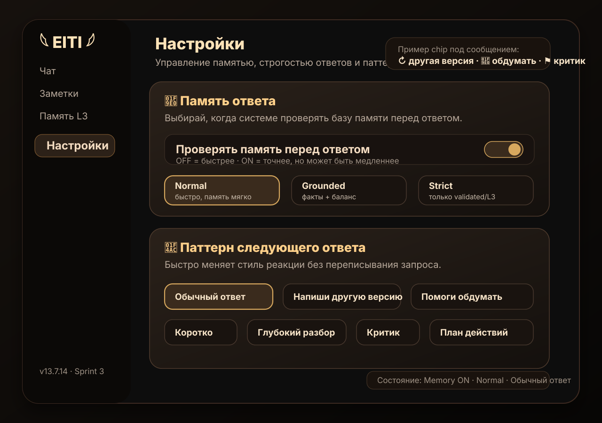

# Sprint 3 — Memory Modes & Response Patterns

Sprint 3 focuses on making Velantrim's memory behavior controllable by the user.

The goal is not to force every answer through the heaviest memory path. The goal is to let the user choose when memory should be fast, grounded, or strict.

## UI wireframe



The planned UI has two user-facing blocks:

1. **Управление памятью** — L1 chat-archive search toggle plus a separate `Normal / Grounded / Strict` mode selector.
2. **Паттерн следующего ответа** — quick buttons such as `Напиши другую версию`, `Помоги обдумать`, `Критик`, `План действий`.

## What this adds

This PR introduces a versioned contract in:

```text
data/sprint3_memory_response_contract_v1.json
```

It defines:

- memory lookup toggle;
- Normal / Grounded / Strict memory modes;
- unified ESM statuses;
- reusable response patterns such as "Напиши другую версию" and "Помоги мне это обдумать";
- stable localStorage keys for future UI wiring.

## Memory lookup toggle

Storage key:

```text
eiti_memory_lookup_enabled
```

This key controls only automatic search of L1 chat-message history; it does not control L2 digests, the active profile, KB, or other memory sources.

Runtime wiring is implemented in v13.7.15. The default is **off**: ordinary messages do not trigger an archive scan. Explicit chat-history requests and manual history search continue to work when the toggle is off. When enabled, ordinary messages may search the archive.

## Memory modes

| Mode | Policy | Intended behavior |
|---|---|---|
| `normal` | `opportunistic` | Fast default. Memory is used when cheap/relevant, not as a mandatory gate. |
| `grounded` | `required_when_memory_relevant` | Balanced. Use source facts when the answer depends on remembered user/project facts. |
| `strict` | `required` | Maximum rigor. Only validated or immutable core facts can support confident claims. |

## ESM statuses

Sprint 3 standardizes these statuses:

```text
observed
hypothesis
supported
validated
contradicted
deprecated
immutable_core
```

This prevents memory drift where different parts of the app use different words for the same epistemic state.

## Response patterns

Response patterns are reusable answer intents. They should eventually be exposed in Settings or near the message controls.

Initial patterns:

| Pattern | User-facing meaning |
|---|---|
| `default` | Обычный ответ |
| `rewrite_variant` | Напиши другую версию |
| `think_with_me` | Помоги мне это обдумать |
| `short_answer` | Коротко |
| `deep_dive` | Глубокий разбор |
| `critic` | Критик |
| `action_plan` | План действий |

## Why this matters

Without this control, the app may feel slower because it checks the memory database even when the user only needs a quick conversational answer.

With this contract, the intended behavior becomes explicit:

- `normal` for speed;
- `grounded` for balanced memory use;
- `strict` for verified answers;
- response patterns for changing the style or cognitive mode of the next answer.

## Remaining implementation steps

The L1 archive-search toggle is wired into `index.html` and Settings. It is not a global memory-check switch. The remaining Sprint 3 work is to wire the other contract features into `index.html`:

1. Add Settings controls:
   - toggle: "Поиск по архиву чатов" (L1 history only; default OFF);
   - select: `Normal / Grounded / Strict`;
   - select/buttons: response patterns.
2. Persist the mode and response-pattern choices in localStorage using the keys from the contract.
3. Make the chat pipeline apply mode-aware retrieval and response patterns during prompt construction.
4. In strict mode, show source facts / confidence / trace by default.

The contract tests pin the full target behavior; not all modes and response patterns are wired to runtime yet.
